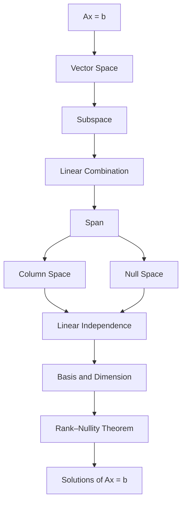

> [!note]- Ax = b
> **Setup.** A system of $m$ linear equations in $n$ unknowns is written $Ax = b$, where
>
> - $A \in M_{m \times n}(\mathbb{R})$ is the coefficient matrix,
> - $x \in \mathbb{R}^n$ is the vector of unknowns,
> - $b \in \mathbb{R}^m$ is the right-hand side.
>
> **Definitions.**
>
> - Augmented matrix: $[\,A \mid b\,]$.
> - Consistent: the system has at least one solution. Otherwise it is inconsistent.
> - Row echelon form (REF): every zero row is at the bottom, and the leading (first non-zero) entry of each row lies to the right of the leading entry of the row above it.
> - Pivot: a leading entry of REF. A pivot column is a column that contains a pivot.
> - Basic variable: a variable whose column is a pivot column. Free variable: a variable whose column is not.
>
> **Questions.** Does a solution exist? Is it unique? What do all the solutions look like? The boxes below build the tools; the last box answers them.

> [!note]- Vector Space
> **Definition.** A vector space is a set $V$ with two operations, addition and scalar multiplication, such that the following 10 axioms hold for all $u, v, w \in V$ and all scalars $c, d \in \mathbb{R}$.
>
> **Addition**
>
> 1. Closure: $u + v \in V$
> 2. Commutativity: $u + v = v + u$
> 3. Associativity: $(u + v) + w = u + (v + w)$
> 4. Zero vector: there is a $0 \in V$ with $u + 0 = u$
> 5. Additive inverse: each $u$ has a $-u \in V$ with $u + (-u) = 0$
>
> **Scalar multiplication**
>
> 6. Closure: $cu \in V$
> 7. Distributivity over vectors: $c(u + v) = cu + cv$
> 8. Distributivity over scalars: $(c + d)u = cu + du$
> 9. Associativity: $c(du) = (cd)u$
> 10. Identity: $1u = u$
>
> **Examples.**
>
> | Space | Elements |
> |---|---|
> | $\mathbb{R}^n$ | columns of $n$ real numbers |
> | $P_n$ | polynomials of degree at most $n$ |
> | $M_{m \times n}$ | $m \times n$ real matrices |
> | $C(\mathbb{R})$ | continuous functions on $\mathbb{R}$ |

> [!note]- Subspace
> **Definition.** A subspace of $V$ is a subset $W \subseteq V$ that is itself a vector space under the operations of $V$.
>
> **Subspace test.** $W$ is a subspace if and only if
>
> 1. Zero vector: $0 \in W$
> 2. Closure under addition: $u, v \in W \Rightarrow u + v \in W$
> 3. Closure under scalar multiplication: $u \in W,\ c \in \mathbb{R} \Rightarrow cu \in W$
>
> The other axioms are inherited from $V$.
>
> **Non-example.** $W = \left\{ (0, m, n)^T : m, n \in \mathbb{Z} \right\} \subseteq \mathbb{R}^3$ is not a subspace: it is not closed under scalar multiplication, since $\tfrac{1}{2}(0, 1, 1)^T \notin W$.

> [!note]- Linear Combination
> **Definition.** A linear combination of $v_1, \dots, v_k \in V$ is a vector of the form
>
> $$c_1 v_1 + c_2 v_2 + \cdots + c_k v_k, \qquad c_1, \dots, c_k \in \mathbb{R}$$
>
> The scalars $c_1, \dots, c_k$ are the weights.

> [!note]- Span
> **Definition.** The span of $v_1, \dots, v_k$ is the set of all their linear combinations:
>
> $$\text{Span}\{v_1, \dots, v_k\} = \{ c_1 v_1 + \cdots + c_k v_k : c_i \in \mathbb{R} \}$$
>
> **Properties.**
>
> - $\text{Span}\{v_1, \dots, v_k\}$ is always a subspace of $V$.
> - If $\{v_1, v_2, \dots, v_k\}$ spans $V$, then so does
>
>   $$\{v_1,\ v_1 + v_2,\ \dots,\ v_1 + v_2 + \cdots + v_k\}$$

> [!note]- Column Space
> **Definition.** For $A \in M_{m \times n}(\mathbb{R})$ with columns $A_1, \dots, A_n$, the column space of $A$ is
>
> $$\mathcal{C}(A) = \text{Span}\{A_1, \dots, A_n\} = \{ Ax : x \in \mathbb{R}^n \} \subseteq \mathbb{R}^m$$
>
> **Remark.** $Ax$ is a linear combination of the columns of $A$, with the entries of $x$ as weights:
>
> $$Ax = x_1 A_1 + x_2 A_2 + \cdots + x_n A_n$$
>
> **Theorem.** ==$Ax = b$ is consistent $\iff b \in \mathcal{C}(A)$==

> [!note]- Null Space
> **Definition.** For $A \in M_{m \times n}(\mathbb{R})$, the null space of $A$ is
>
> $$\mathcal{N}(A) = \{ x \in \mathbb{R}^n : Ax = 0 \} \subseteq \mathbb{R}^n$$
>
> **Properties.**
>
> - $\mathcal{N}(A)$ is a subspace of $\mathbb{R}^n$.
> - If $x_p$ is one solution of $Ax = b$, then every solution has the form $x = x_p + x_h$ with $x_h \in \mathcal{N}(A)$.

> [!note]- Linear Independence
> **Definition.** $\{v_1, \dots, v_k\}$ is linearly independent if
>
> $$c_1 v_1 + \cdots + c_k v_k = 0 \quad \Rightarrow \quad c_1 = \cdots = c_k = 0$$
>
> Otherwise it is linearly dependent: some non-trivial combination gives $0$, so one of the vectors is a linear combination of the others.
>
> ==No redundancy: the only combination that gives $0$ is the trivial one.==
>
> **Theorem.** For $A \in M_{m \times n}(\mathbb{R})$, the following are equivalent:
>
> - the columns of $A$ are linearly independent;
> - $\mathcal{N}(A) = \{0\}$;
> - $Ax = 0$ has only the trivial solution.
>
> **Example.** If $\{u, v\}$ is linearly independent, then so is $\{u + v,\ u - v\}$.
>
> $$a_1(u + v) + a_2(u - v) = (a_1 + a_2)u + (a_1 - a_2)v = 0$$
>
> Since $\{u, v\}$ is independent, $a_1 + a_2 = 0$ and $a_1 - a_2 = 0$, so $a_1 = a_2 = 0$.

> [!note]- Basis and Dimension
> **Definition.** A basis of $V$ is a set of vectors in $V$ that
>
> 1. is linearly independent, and
> 2. spans $V$.
>
> **Theorem.** If $\{v_1, \dots, v_k\}$ is a basis of $V$, every $v \in V$ can be written as $c_1 v_1 + \cdots + c_k v_k$ in exactly one way.
>
> **Definition.** The dimension of $V$, $\dim V$, is the number of vectors in a basis of $V$. Every basis of $V$ has the same number of vectors.
>
> **Definition.** The row space of $A$ is $\mathcal{R}(A)$ = span of the rows of $A$ $= \mathcal{C}(A^T) \subseteq \mathbb{R}^n$.
>
> **Finding a basis.**
>
> | Space | Basis |
> |---|---|
> | $\mathcal{C}(A)$ | the pivot columns of the original $A$ |
> | $\mathcal{N}(A)$ | one vector per free variable, from the solution of $Ax = 0$ |
> | $\mathcal{R}(A)$ | the non-zero rows of REF |
>
> **Example.** $V = \{ A \in M_{3 \times 3}(\mathbb{R}) : A^T = -A \}$. The condition $A^T = -A$ forces a zero diagonal and $a_{ji} = -a_{ij}$:
>
> $$A = \begin{bmatrix} 0 & b & c \\ -b & 0 & d \\ -c & -d & 0 \end{bmatrix} = b \begin{bmatrix} 0 & 1 & 0 \\ -1 & 0 & 0 \\ 0 & 0 & 0 \end{bmatrix} + c \begin{bmatrix} 0 & 0 & 1 \\ 0 & 0 & 0 \\ -1 & 0 & 0 \end{bmatrix} + d \begin{bmatrix} 0 & 0 & 0 \\ 0 & 0 & 1 \\ 0 & -1 & 0 \end{bmatrix}$$
>
> The three matrices form a basis, so $\dim V = 3$.

> [!note]- Rank–Nullity Theorem
> **Definitions.** For $A \in M_{m \times n}(\mathbb{R})$:
>
> - $\text{rank}(A) = \dim \mathcal{C}(A) = \dim \mathcal{R}(A)$ = number of pivots
> - $\text{nullity}(A) = \dim \mathcal{N}(A)$ = number of free variables
>
> **Theorem (Rank–Nullity).** ==$\text{rank}(A) + \text{nullity}(A) = n$==
>
> Equivalently: number of pivots + number of free variables = number of columns = number of unknowns.

> [!note]- Solutions of Ax = b
> For $A \in M_{m \times n}(\mathbb{R})$:
>
> | Space | What it answers |
> |---|---|
> | $\mathcal{C}(A)$ | Existence: a solution exists $\iff b \in \mathcal{C}(A)$ |
> | $\mathcal{R}(A)$ | If consistent, how many equations are necessary to solve it: $\text{rank}(A)$ |
> | $\mathcal{N}(A)$ | Uniqueness and the form of all solutions: $x = x_p + x_h,\ x_h \in \mathcal{N}(A)$ |
>
> | Property | REF | Rank | Space |
> |---|---|---|---|
> | consistent for every $b$ | a pivot in every row | $\text{rank}(A) = m$ | $\mathcal{C}(A) = \mathbb{R}^m$ |
> | at most one solution | a pivot in every column, no free variables | $\text{rank}(A) = n$ | $\mathcal{N}(A) = \{0\}$ |
>
> **Corollary.** $Ax = b$ has exactly one solution for every $b$ $\iff \text{rank}(A) = m = n$, that is, $A$ is square and invertible.
