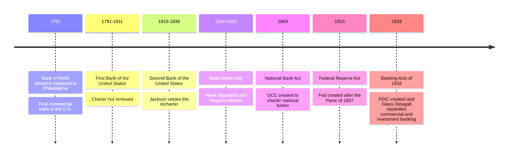

In most countries, 4 or 5 banks dominate the banking industry. In the U.S., there are more than 3,700 commercial banks, 43 savings and loan associations, 432 savings banks, and 4,214 credit unions (as of June 30, 2026). 

Let's take a closer look at the structure of the banking industry in the United States and its historical development. 

## Historical Development of the Banking System 
The U.S. banking system grew out of a long fight over **central versus local control** of banking. Each crisis added a new regulator, and none was ever removed.

- **1791–1836:** Agrarian and state interests distrusted a powerful central bank in the East, so both Banks of the United States lost their charters. The U.S. had **no central bank until 1913**.
- **1836–1863:** State banks issued their own banknotes under loose state rules. Many failed, and some of their owners ran off with depositors' funds.
- **1863:** The National Bank Act created the **Office of the Comptroller of the Currency (OCC)** to charter **national banks**. It also taxed state banknotes to drive state banks out, but they survived by switching to deposits. The result is the **dual banking system**: national banks and state banks operate side by side.
- **1913:** After the Panic of 1907, the Federal Reserve Act created the **Federal Reserve System**. National banks **must** join the Fed, while state banks **may choose** to join.
- **1933:** The bank failures of 1930–1933 led to the **Federal Deposit Insurance Corporation (FDIC)**. Fed member banks must buy FDIC insurance, and most nonmember banks choose to. 

### Regulatory Agencies 
Because of the dual banking system, U.S. commercial banks answer to **multiple overlapping regulators**. Which one is a bank's primary supervisor depends on **who chartered it** and **whether it is a Fed member**.

| Regulator                                         | Created | Primary supervisor of                                                |
| ------------------------------------------------- | ------- | -------------------------------------------------------------------- |
| *OCC* (Office of the Comptroller of the Currency) | 1863    | *National banks*, which hold most commercial bank assets             |
| *Federal Reserve*                                 | 1913    | *State member banks* and all *bank holding companies*                |
| *FDIC*                                            | 1933    | *State nonmember banks*, and it insures deposits at nearly all banks |
| *State banking authorities*                       | —       | *State-chartered banks*, shared with the Fed or the FDIC             |

*Who Supervises U.S. Commercial Banks*

- **National banks are automatically Fed members**, but the **OCC** is their main examiner.
- The overlap lets banks **switch charters to pick a more lenient regulator** (*regulatory arbitrage*). 

## Financial Innovation 
Banks are the most important financial institutions and among the most heavily regulated. Like other businesses, financial institutions **invent new products to earn profits**, and changes in demand, supply and regulation create the openings. Together, these innovations produced the *shadow banking system*, in which **bank lending has been replaced by lending via the securities markets**. 

### Responses to Changes in Demand Conditions 
Interest rates became much more volatile starting in the 1970s, which raised **interest-rate risk**. Institutions created products to manage that risk.

#### Adjustable-Rate Mortgages 
The interest rate on an adjustable-rate mortgage (ARM) **moves with a market rate**, such as the Treasury bill rate. When rates rise, the lender's income rises too, so it is protected from interest-rate risk. Borrowers accept ARMs because the starting rate is lower than on a fixed-rate mortgage.

#### Financial Derivatives 
Financial derivatives are instruments whose **payoffs are linked to previously issued securities**. In the 1970s, exchanges began trading *financial futures*, which let institutions hedge interest-rate risk by locking in prices today for trades in the future.

### Responses to Changes in Supply Conditions: Information Technology 
Cheaper computing and telecommunications **lowered the cost of processing transactions** and made information about borrowers easier to get. Both made new products profitable.

#### Bank Credit and Debit Cards 
A card that works everywhere needs a network to approve purchases and settle bills between banks, which was **expensive until computers cut the cost**.

- **1950:** Diners Club, the first general-purpose card.
- **1958:** Bank of America mailed unsolicited BankAmericards to customers in Fresno, California, launching the first big bank credit card.
- **1966:** Bank of America began licensing BankAmericard to other banks. Rival banks formed the Interbank Card Association, whose card later became MasterCard.
- **1976:** BankAmericard was renamed Visa, a name that sounds the same in every language, so the card could expand worldwide.
- **1985:** Sears launched Discover.

A *debit card* looks like a credit card, but the purchase is paid straight out of the holder's bank account. No credit is extended.

#### Electronic Banking 
ATMs, phone banking and internet banking let customers bank anytime at a **much lower cost to the bank**. *Virtual banks* operate entirely online, with no physical branches.

#### Junk Bonds 
Junk bonds are bonds rated below investment grade. Before the late 1970s, only large, well-known firms could sell bonds. Better information made it easier for investors to **judge the risk of smaller, lesser-known firms**, so new junk bonds began to be sold directly, paying high yields for higher default risk.

#### Commercial Paper Market 
Commercial paper is short-term debt issued by large banks and corporations. Better information made it easier to screen out bad credit risks, so the market grew, and **firms could borrow in this market instead of from banks**. Money market mutual funds became major buyers.

#### Securitization 
Securitization **bundles small, illiquid loans into marketable securities**, such as mortgages, auto loans and credit card receivables. Computers lowered the cost of bundling the loans and collecting their payments. Mortgage-backed securities are the best-known example, and they played a central role in the [[money-and-banking-14-financial-crises#Causes of the 2007-2009 Financial Crisis|2007–2009 financial crisis]].

### Avoidance of Existing Regulations 
Two rules squeezed banks when market interest rates rose in the 1960s and 1970s. **Reserve requirements** worked like a tax, since reserves earned no interest, and **Regulation Q** capped the interest banks could pay on deposits. This search for loopholes is called loophole mining.

Regulation Q's caps on savings and time deposits were phased out by 1986 under a 1980 law, and its ban on interest on checking accounts ended in 2011 under the Dodd-Frank Act.

#### Money Market Mutual Funds 
Money market mutual funds invest in short-term debt and let shareholders write checks against their shares at a fixed price of \$1. Their shares are **not legally deposits**, so they escaped reserve requirements and Regulation Q's interest-rate ceilings. They took off in the late 1970s.

#### Sweep Accounts 
In a sweep account, any balance in a firm's checking account above a set amount is swept out each night into interest-paying securities (such as overnight repos) and returned the next morning. The swept funds are not checkable deposits, so the bank **avoids reserve requirements**, and the firm earns interest that banks were not allowed to pay on business checking accounts.

## Structure of the U.S. Commercial Banking Industry 
The U.S. has far more commercial banks than other countries, but most of them are small. About three-quarters have less than \$1 billion in assets, yet together they hold **less than 4% of the industry's assets**. The 10 largest banks hold 56%.

| Bank size (total assets) | Banks | % of banks | % of assets |
| ------------------------ | ----- | ---------- | ----------- |
| Less than \$100 million | 470 | 12.5 | 0.1 |
| \$100 million – \$1 billion | 2,378 | 63.2 | 3.6 |
| \$1 billion – \$10 billion | 770 | 20.5 | 8.5 |
| \$10 billion – \$250 billion | 128 | 3.4 | 22.0 |
| More than \$250 billion | 18 | 0.5 | 65.8 |
| Total | 3,764 | 100 | 100 (\$25.6 trillion) |
*Size Distribution of U.S. Commercial Banks (FDIC data, June 30, 2026)*

### Restrictions on Branching 
So many small banks survived because of **state limits on branching**, not because they were efficient.

- Many states had *unit banking* laws, which allowed a bank only one office. Others limited branches to one city or county.
- The **McFadden Act (1927)** made national banks follow their home state's branching rules, which in practice banned branching across state lines.
- The limits came from public distrust of big banks and from small banks that wanted protection from competition.

### Responses to Branching Restrictions 

#### Bank Holding Companies 
A bank holding company is a corporation that owns one or more banks. By owning several separate banks, it could **get around branching limits**, within a state or across states where state law allowed it. It could also own nonbank businesses. Nearly all large banks are now owned by holding companies, which the Fed supervises.

Today, JPMorgan Chase & Co. is a holding company. It owns JPMorgan Chase Bank, N.A., a national bank supervised by the OCC, and J.P. Morgan Securities LLC, a securities firm. The Fed supervises the parent.

#### ATMs 
Banks shared ATM networks. A bank did not own or rent the shared machines, so they did not count as branches.

## Bank Consolidation and Nationwide Banking 
The number of U.S. commercial banks has fallen from over 14,000 in the mid-1980s to roughly 3,700 today. Many banks failed in the 1980s and early 1990s, and **branching limits were removed**, which let banks merge across state lines.

In the 1980s, many states began letting out-of-state holding companies buy their banks, often only within a region. Then the **Riegle-Neal Interstate Banking and Branching Efficiency Act (1994)** allowed holding companies to buy banks in any state and banks to **branch nationwide**.

## Thrift Industry 
*Thrift institutions* (thrifts) are savings and loan associations, mutual savings banks and credit unions. They began as places for **ordinary households to save and borrow**, mainly for homes and consumer loans. Their regulation looks like that of commercial banks: a dual charter system (federal or state), deposit insurance and overlapping regulators.

#### Savings and Loan Associations 
A savings and loan association (S&L) **takes savings deposits and uses them to make home mortgages**. S&Ls began in the 1800s as local clubs where members pooled their savings so that each could buy a house.

- They can be federally or state chartered. 
- In the 1980s, many S&Ls failed. They held long-term, fixed-rate mortgages funded by short-term deposits, so when interest rates rose sharply, they lost money. 
- After the crisis, S&L deposits moved to the **FDIC**. Federal S&Ls are now supervised by the OCC and state S&Ls by the FDIC.

#### Mutual Savings Banks 
A mutual savings bank is much like an S&L, but it is **owned by its depositors** rather than by stockholders. Profits go back to depositors, and there are no outside shareholders.

- They are concentrated in the Northeast, where they began in the early 1800s to encourage working people to save.
- Most are state chartered and supervised by the state and the FDIC. Many have converted to stock ownership to raise capital.

#### Credit Unions 
A credit union is a **nonprofit cooperative** owned by its members, who share a *common bond*, such as the same employer, union or community. Members' savings are called shares, and the credit union lends them out to other members, mostly as consumer loans and mortgages.

- They are federally or state chartered. The **National Credit Union Administration (NCUA)** charters federal credit unions and insures deposits at almost all of them.
- As nonprofits, they are **exempt from federal income tax**, which lets them offer better rates.

## International Banking 
U.S. banks expanded abroad rapidly from the 1960s, following their corporate customers into foreign markets and **escaping strict U.S. regulations**. A key example is the *Eurodollar* market: U.S. dollar deposits held in banks outside the United States, mostly in London, which avoided reserve requirements and Regulation Q's interest-rate ceilings.

U.S. banks do business abroad in three ways. A *foreign branch* is simply an office of the bank in another country. An *Edge Act corporation* is a separate company the bank owns in the U.S. that may do only international business, such as financing trade. An *international banking facility* (since 1981) is a separate set of accounts inside a U.S. office, for foreign customers only. It is free of reserve requirements and interest-rate limits.

Foreign banks also do business in the U.S. The International Banking Act (1978) put them under largely the same rules as U.S. banks, so they would not have an unfair advantage.
